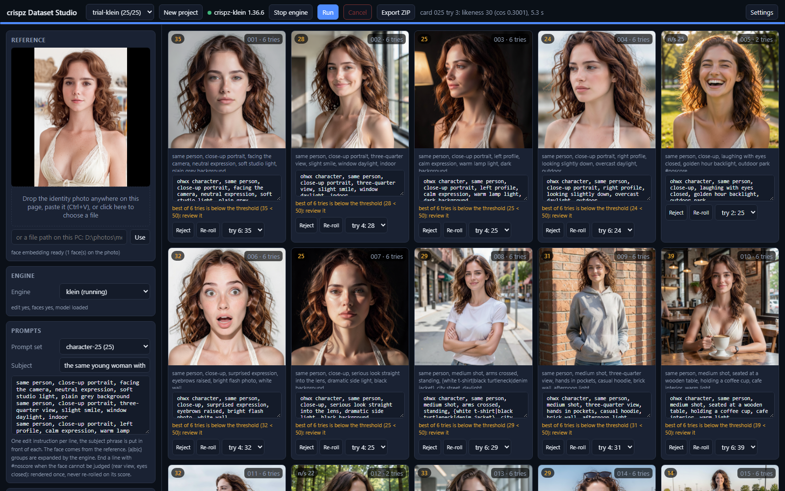
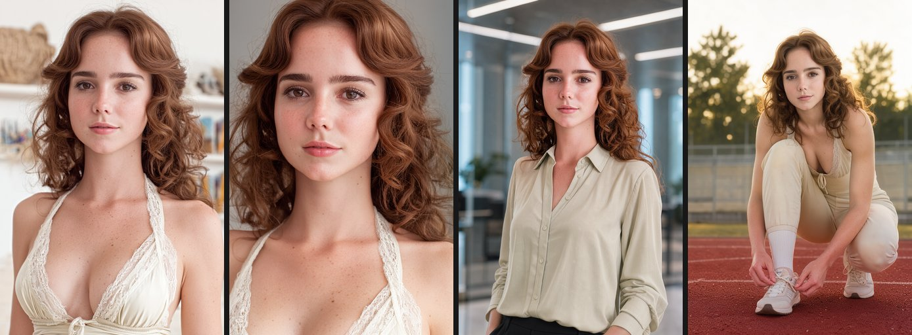
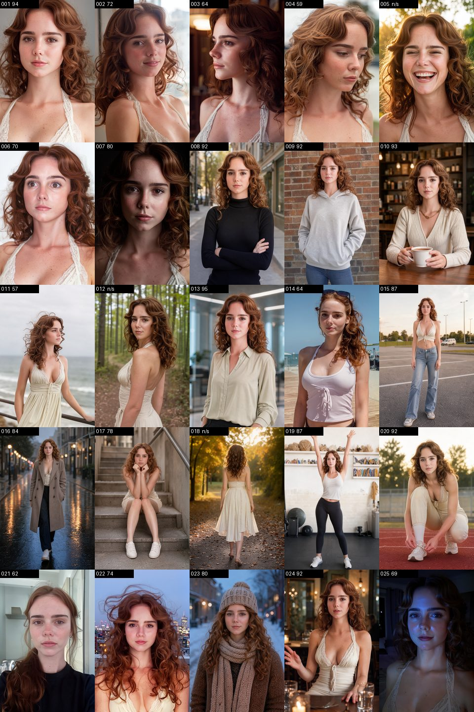

# crispz-dataset-studio

> One reference photo in, a captioned, likeness-checked character LoRA dataset out.
> A standalone local app that drives the crispz family engines (crispz-klein,
> crispz-qwen-edit, crispz-flux3) through their CLI protocol v1, and starts them itself.
> Version 0.1.0 (2026-10-29), local work in progress.



## What it does

1. Drop a reference photo (only its main face matters).
2. Pick a prompt set (25 shots: framing, angles, expressions, poses, places, light), or
   edit the lines.
3. Run. For every line the engine edits the reference with that instruction, the
   engine's face service (insightface, the same as its Face Swap) gives the ArcFace
   embedding of the result, and the likeness against the reference is scored 0-100.
   Below the threshold the card is re-rolled with a new seed (up to N times); the best
   try is kept and the card says when it stayed below. Size: a fixed width x height,
   or "Reference size" (no size sent, the engine keeps the input's own). Speed: the
   engine's setting, or `fast` of the edit op (Lightning 8 / 4 steps with the edit
   LoRA, auto, off); Steps and Guidance empty = the engine's defaults.
4. Captions: the prompt line (trigger word first), a local Ollama vision model, or both.
5. Review the grid: reject, restore, re-roll a card, pick another try, edit a caption.
6. Export the `001.png` + `001.txt` pairs (kohya, ai-toolkit, OneTrainer), long side
   1024 / 1536 / 2048, PNG or JPG, to the output folder of Settings with the crispz
   layout: `out/YYYY-MM-DD/<project>_<YYYYMMDD-HHMMSS>/` (one lot per export, never
   overwritten) and the ZIP of the same name beside it. The viewer walks the cards
   with Prev / Next or the arrow keys.

Everything is on disk under `projects/<name>/` (`project.json`, `reference.png`,
`cards/NNN_tK.png`): a run resumes where it stopped and re-renders only the pending,
rejected or failed cards.

## The engine is started for you

Settings lists the family engines with their install folder and URL. When nothing
answers at the URL, Dataset Studio starts `<folder>/app.py` with the folder's `.venv`
(then Pinokio's `env`, then `py -3`), passes the URL's port through
`GRADIO_SERVER_PORT`, logs to `logs/<engine>.log`, and waits for the `cli_caps`
endpoint. No change is needed in the engines: they already read that variable and do
not open a browser. Give each engine its own port (7861, 7862, 7863 in
`config-sample.json`). One engine at a time: two family apps do not fit on one GPU,
so a second launch is refused until the first is stopped from Settings. An engine you
started by hand is used as is and never killed.

The model loads at the first image, so the first card of a session is slow.

## Install and run

Server: Python stdlib. Dependency: Pillow. `run.bat` reuses a family venv when it
finds one next door (`../crispz-klein/.venv`), else `install.bat` makes a `.venv`.

```bash
run.bat                 # http://127.0.0.1:8780
python ds_server.py --port 8780 --no-browser
```

Tests (CPU, a fake engine, no model): `python -m pytest tests -q` (27 tests).

## Likeness scale

score = ArcFace cosine x 100, clamped. Same person photos usually sit above 50,
different people below 30; a generated image of the same identity lands in between.
The default threshold 35 is a floor for clear drift, to calibrate after a first batch
on the real engine (the raw cosine is kept per try in `project.json`).

## Status (2026-10-30)

- Done on CPU: engine client and launcher, project state, run loop with re-rolls and
  resume, captions (prompt / Ollama / both), export, SPA, 23 tests.
- First real run on crispz-klein (2026-10-29, RTX 5090): klein launched by Dataset
  Studio in 10 s on port 7861 (its own .venv); FLUX.2-klein-9B under model offload
  (klein's own choice on 32 GB), 9 to 45 s per edit at 1024, 3 cards x 2 tries in
  170 s. The identity (a comic character) was kept in the two comic cards and turned
  photoreal in the "studio portrait" one; ArcFace cosines stayed at 0.03 to 0.29, so
  the 35 threshold is too high for a drawn character and the scale needs a photo
  reference to calibrate.
- Second run, same day, a photo-like reference (a stylised character portrait) on
  klein-4B through the per-project Model setting (spec.model, the user's app keeps
  its 9B): 4B loaded in 16 s, 3 s per edit, 4 s per card with the face round trip,
  3 cards in 34 s, 17.9 GB resident. Likeness 56 / 64 / 79, all above the threshold
  at the first try, and the eye agrees (the 79 keeps every feature, the 56 drifts a
  little on a close-up). So: threshold 35 is a safe drift floor, 50 a quality floor,
  on a photo reference; a drawn reference needs its own, lower scale.
- Full 25-shot run on the same reference, klein-4B, threshold 50, 2 re-rolls: 25 cards
  in 247 s, 54 tries at 5.2 s each, scores 9 to 80 (mean 51), 10 cards passed at the
  first try, 10 stayed below 50 after 3 tries. The weak ones are telling: a rear view
  or closed eyes give ArcFace nothing to compare (scores 9 and 19 on cards that LOOK
  right), and close-ups that re-describe the face ("no makeup look") lose the
  character's non-human traits. Two things to add: an "unscored" mark for lines the
  face model cannot judge (no re-roll on score), and a subject description prefixed
  to every line ("the same black panther humanoid, ..."), the identity phrase the
  25-shot packs rely on. Both were added the same evening and the 8 weak scored
  cards were re-rendered with the subject phrase "the same black panther humanoid
  character with a hair bun and small earrings": 7 of 8 now pass 50 (46 to 65, the
  bathroom close-up went from a plain human at 26 to the character at 50), mean of
  the 22 scored cards 60, the 3 unscored lines rendered once. Then crispz-qwen-edit.
- crispz-qwen-edit (2026-10-30, same 3 cards, seed 1000, Qwen-Image-Edit-2511 Q6
  GGUF): the first pass came back ghosted and tiled although ArcFace said 54 to 60.
  Two causes, both on the Dataset Studio side: it sent 1024x1024 for a 896x1344
  reference (the edit was recomposed into a square) and no speed mode, so the engine
  ran its 8-step default without the Lightning LoRA. With "Reference size" and
  Speed = Lightning 8 steps (spec.fast, the 2511 Lightning LoRA stacked by the
  engine): clean edits at 832x1248 in 33 to 42 s, likeness 63 / 52 / 57. The control
  lot at 40 steps / CFG 4 without the LoRA scored 79 / 76 / 28 but barely edited
  (two cards are the reference re-rendered) at 115 to 147 s: a high score is not an
  edit. So on qwen-edit: Reference size + Lightning 8.
- Visual checks beside the likeness (same day, `ds_quality.py`): a try whose 32x32
  grayscale correlation with the reference is 0.9 or more is flagged as "the
  reference copied back" (real edits measured 0.69 at most, the copies 0.95 and
  0.98), and, when "artifacts (Ollama vision)" is ticked, the caption model answers
  one closed question (ghosting, doubling, tiling) and a YES flags the try. A flagged
  try is re-rolled like a low score, the best unflagged try wins, and the card says
  when the kept try is still flagged. 26 tests.
- Captions follow the engine's draw (same day): the engines expand the `{a|b|c}`
  groups of a prompt line themselves, bound to the seed, and only the PNG's `crispz`
  chunk carries the line they rendered. The first exported lot had two captions
  still reading `{dark suit|elegant blouse}`; the caption is now built from that
  chunk (subject prefix stripped), the raw line stays the card's key. 27 tests.
- The 25 shots on the three engines, same photo-like reference (896x1344), same
  subject phrase, threshold 50, 2 re-rolls, Reference size (2026-10-30, RTX 5090):

  | engine | setting | mean (22 scored) | pass at 50 | first try | tries | per try |
  |---|---|---|---|---|---|---|
  | crispz-klein, FLUX.2-klein-4B | 1024x1024 | 60 | 19 / 22 | 10 | 54 | 5 s |
  | crispz-qwen-edit, 2511 Q6 GGUF | Lightning 8 | 53 | 15 / 22 | 8 | 49 | 61 s |
  | crispz-flux3, FLUX.3 Image Klein | 16 steps | 79 | 22 / 22 | 22 | 25 | 16 s |

  flux3 keeps the face on every framing (94 on the frontal close-up, 87 to 92 on the
  full-body shots, 57 on the weakest), no try looked like the reference (copy
  similarity 0.39 at most), 25 cards in 7 minutes; its one drift is the hair, auburn
  turning chestnut. qwen-edit renders beautiful scenes but loses the face on
  profiles and small faces (27 to 36), and a full-body try takes 60 to 100 s.
  klein-4B is the fastest and holds the middle. So the default engine for a
  character dataset is flux3 when the card fits (19 GB), klein-4B otherwise.

  The flux3 lot, left to right: the reference, card 001 (close-up, 94), card 013
  (office, 95; the engine drew "elegant blouse" from the `{dark suit|elegant blouse}`
  group), card 020 (crouching, 92):

  

  The 25 cards with their likeness (n/s = not scored: laughing, back view, eyes
  closed, the face model cannot judge them). Every card is the first try:

  

  | card | 001 | 002 | 003 | 004 | 005 | 006 | 007 | 008 | 009 | 010 | 011 | 012 | 013 |
  |---|---|---|---|---|---|---|---|---|---|---|---|---|---|
  | likeness | 94 | 72 | 64 | 59 | n/s | 70 | 80 | 92 | 92 | 93 | 57 | n/s | 95 |

  | card | 014 | 015 | 016 | 017 | 018 | 019 | 020 | 021 | 022 | 023 | 024 | 025 |
  |---|---|---|---|---|---|---|---|---|---|---|---|---|
  | likeness | 64 | 87 | 84 | 78 | n/s | 87 | 92 | 62 | 74 | 80 | 92 | 69 |

  Exported as `out/2026-10-30/trial-flux3_<stamp>/`: 25 pairs `NNN.png` (683x1024,
  long side 1024) + `NNN.txt`, and the ZIP beside it. The test suite on the same day:

  ```
  python -m pytest tests -q
  ...........................                                              [100%]
  27 passed in 48.20s
  ```
- Family fix shipped with it: `cli_faces` imported a function that did not exist in
  klein and flux3 (`detect_faces_full`), so no client could get embeddings.
- Later: a `dataset` op in the family protocol so the same run can be driven without
  the UI; a bounding-box / outfit lock; per-card prompt overrides.
