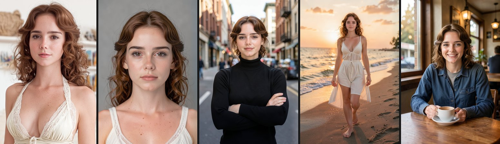
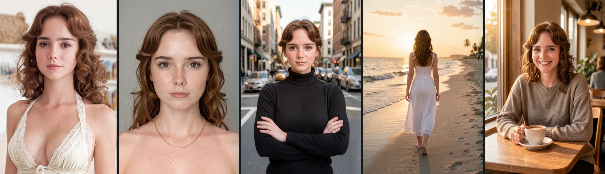

# Rapport : LoRA de personnage pour FLUX.2 Klein depuis un lot crispz-dataset-studio

Date : 31 octobre 2026, RTX 5090 (32 Go), Windows 11.
Objectif : vérifier qu'un dataset sorti de Dataset Studio (25 rendus flux3 du personnage
`ohwx character`) s'entraîne tel quel dans ai-toolkit (Ostris) et que le LoRA obtenu
fonctionne dans crispz-klein.

Résultat en une ligne : **les deux LoRAs sont entraînés et reconnus dans crispz-klein.
Klein 4B : 1500 pas en 24 min, 46 Mo, ressemblance ArcFace moyenne 57 contre 1,5 sans LoRA.
Klein 9B : 1500 pas en 50 min, 83 Mo, moyenne 65 sur les plans où le visage est visible,
contre 2 sans LoRA.** Le 9B a d'abord été bloqué par le gate HF du repo
`black-forest-labs/FLUX.2-klein-base-9B`, levé par Mike dans la matinée.

## 1. Chronologie et actions

| Heure | Action |
|---|---|
| 30/10 22:06 | Export du projet `trial-flux3` (25 paires PNG + TXT, grand côté 1024) |
| 30/10 22:30 | Copie du lot dans `AI-Toolkit\datasets\ohwx_flux3` (dossier déclaré par l'UI ai-toolkit) |
| 08:37 | Config `ohwx_flux3_klein4b_v1.yaml` écrite (voir §3) |
| 08:38 | Lancement de l'entraînement 4B ; téléchargement du transformer base 4B (7,3 Go), de Qwen3-4B (7,6 Go) et du VAE (321 Mo) |
| 08:41 | Latents en cache, 4 échantillons de départ |
| 08:45 | Pas 250 (0,8 s par pas) |
| 09:05 | Pas 1500, `ohwx_flux3_klein4b_v1.safetensors` écrit |
| 09:06 | Lancement automatique du 9B : échec 403 (repo gated, accès non accordé) |
| 09:10 | LoRA copié dans `crispz-klein\loras`, 8 rendus de test (4 prompts, avec et sans LoRA) |
| 09:25 | Premier passage invalidé : crispz-klein était sur le 9B, le LoRA a été sauté (tailles cachées 3072 contre 4096, message du moteur). Relance avec `--klein-model black-forest-labs/FLUX.2-klein-4B` |
| 09:35 | Notation ArcFace des 8 rendus face à la référence via le moteur klein (Dataset Studio) |
| 09:22 et 09:33 | Deux relances du 9B refusées (403) : le gate n'était pas encore accepté par le compte KimHose |
| 09:38 | Gate accepté, lancement du 9B ; téléchargement du transformer base 9B (18 Go) et de Qwen3-8B (16 Go) |
| 09:44 | Latents en cache, échantillons de départ ; pas 250 à 09:52 (1,6 s par pas, 24 Go de VRAM) |
| 10:35 | Pas 1500, `ohwx_flux3_klein9b_v1.safetensors` écrit (83 Mo) |
| 10:40 | LoRA copié dans `crispz-klein\loras`, 4 rendus sur le 9B distillé, notation des 16 images |

## 2. Résultats

### Entraînement 4B (ai-toolkit)

| Mesure | Valeur |
|---|---|
| Modèle d'entraînement | `black-forest-labs/FLUX.2-klein-base-4B` (base non distillée), encodeur Qwen3-4B en 8 bits, transformer en bf16 |
| Dataset | 25 images 683x1024, buckets 512 / 768 / 1024, légendes `ohwx character, ...` |
| LoRA | rang 16, alpha 16, adamw8bit, lr 1e-4, sigmoid, 1500 pas, batch 1 |
| Durée | 24 min du premier échantillon au fichier final, dont 5 min d'échantillons (6 x 4 images) |
| Vitesse | 0,8 s par pas (1,2 it/s affiché) |
| VRAM | 17 Go pendant l'entraînement |
| Perte | 0,55 à 0,90 par pas, bruitée, sans tendance nette (normal en flow matching) |
| Sorties | `output\ohwx_flux3_klein4b_v1\ohwx_flux3_klein4b_v1.safetensors` (46 Mo) + sauvegardes à 250 / 500 / 750 / 1000 / 1250, 28 échantillons dans `samples\` |

Échantillons ai-toolkit (prompt 1, portrait face caméra) : à 0 pas une inconnue brune aux
cheveux tirés ; à 250 pas les cheveux et les yeux bruns ; à 1000 pas le personnage est là
(boucles, raie au milieu, taches de rousseur, sourcils, bouche) ; à 1500 pas idem, stable.
Le plan en pied sur la plage à 1500 pas tient aussi le visage.

### Test dans crispz-klein (FLUX.2-klein-4B distillé, 4 pas, guidance 1, seed 42, 832x1216)

Même référence que le dataset, score = cosinus ArcFace x 100 (le même que Dataset Studio).

| Prompt | sans LoRA | avec LoRA 1.0 |
|---|---|---|
| close-up portrait, facing the camera, grey background | 4 | 59 |
| medium shot, black turtleneck, arms crossed, city street | 0 | 63 |
| full body, walking on a beach at sunset, white dress | 0 | 59 |
| sitting at a cafe table with a coffee cup, smiling | 2 | 47 |
| **moyenne** | **1,5** | **57,0** |

Sans LoRA, le mot `ohwx character` ne dit rien au modèle : un homme, puis des inconnus.
Avec le LoRA, le personnage est reconnaissable sur les quatre cadrages, cheveux auburn
bouclés compris. Le score reste sous les 79 des éditions flux3 avec image de référence,
ce qui est attendu : ici le visage sort du seul LoRA, sans image d'entrée, sur un modèle
à 4 pas. Chaque rendu prend 16 à 21 s en ligne de commande, chargement du modèle compris.

Avec LoRA (référence à gauche) :



Sans LoRA, mêmes prompts et seeds :


### Entraînement 9B (ai-toolkit)

| Mesure | Valeur |
|---|---|
| Modèle d'entraînement | `black-forest-labs/FLUX.2-klein-base-9B`, transformer quantifié en 8 bits (qfloat8), Qwen3-8B en 8 bits |
| LoRA | même recette que le 4B : rang 16, alpha 16, adamw8bit, lr 1e-4, sigmoid, 1500 pas |
| Durée | 50 min du premier échantillon au fichier final (1,6 s par pas, échantillons 34 s pièce) |
| VRAM | 24 Go |
| Perte | 0,44 à 0,77 par pas sur le dernier tiers |
| Sorties | `output\ohwx_flux3_klein9b_v1\ohwx_flux3_klein9b_v1.safetensors` (83 Mo) + sauvegardes 250 à 1250, 28 échantillons |

Les échantillons à 1500 pas tiennent le personnage comme le 4B, avec les cheveux plus
franchement auburn (le 4B tire vers le châtain).

Le gate : le 4B base est libre, le 9B base demande d'accepter la licence sur sa page HF
avec le compte dont le jeton est sur la machine (KimHose). Tant que ce n'est pas fait, les
métadonnées du repo se lisent (d'où un faux "accès OK" au premier contrôle) mais le fichier
répond 403, jeton ou pas. `HfApi().auth_check(repo)` est le test fiable.

### Test dans crispz-klein (FLUX.2-klein-9B distillé, 4 pas, offload 'model', seed 42, 832x1216)

| Prompt | sans LoRA | avec LoRA 9B 1.0 |
|---|---|---|
| close-up portrait, facing the camera, grey background | 0 | 63 |
| medium shot, black turtleneck, arms crossed, city street | 0 | 73 |
| full body, walking on a beach at sunset, white dress | pas de visage | pas de visage (vue de dos) |
| sitting at a cafe table with a coffee cup, smiling | 8 | 60 |
| **moyenne (3 plans notés)** | **2,7** | **65,3** |

Le 9B tient le visage un cran au-dessus du 4B (63 / 73 / 60 contre 59 / 63 / 47 sur les
mêmes plans) et garde les taches de rousseur et la couleur auburn. Le plan plage est sorti
de dos avec le même seed : pas de visage, donc non noté. Chaque rendu prend 45 à 54 s en
ligne de commande, chargement et offload compris (le 9B ne tient pas entier en 32 Go).

Avec LoRA 9B (référence à gauche) :



## 3. Lignes de commande utilisées

Export et copie du lot (Dataset Studio tourne sur 8780) :

```bash
curl -s --noproxy '*' -X POST http://127.0.0.1:8780/api/export -H 'Content-Type: application/json' -d '{"name":"trial-flux3"}'
```

```bash
mkdir -p "/d/Github/AI-Toolkit-Easy-Install/AI-Toolkit-Easy-Install/AI-Toolkit/datasets/ohwx_flux3" && cp /d/Github/crispz-dataset-studio/out/2026-10-30/trial-flux3_20261030-220650/*.png /d/Github/crispz-dataset-studio/out/2026-10-30/trial-flux3_20261030-220650/*.txt "/d/Github/AI-Toolkit-Easy-Install/AI-Toolkit-Easy-Install/AI-Toolkit/datasets/ohwx_flux3/"
```

Interpréteur d'ai-toolkit (pas le `python_embeded`, qui n'a pas torch) :
`AI-Toolkit\.venv\Scripts\python.exe` (Python 3.12, torch 2.13 cu130).

Entraînement 4B, depuis `D:\Github\AI-Toolkit-Easy-Install\AI-Toolkit-Easy-Install\AI-Toolkit` (PowerShell) :

```powershell
$env:PYTHONUTF8 = '1'
.\.venv\Scripts\python.exe run.py config\ohwx_flux3_klein4b_v1.yaml --log output\ohwx_flux3_klein4b_v1.log
```

Entraînement 9B (le jeton HF est passé explicitement : ai-toolkit lit `HF_TOKEN` et une
valeur vide dans ses réglages suffit à perdre l'accès aux repos gated) :

```powershell
$env:HF_TOKEN = (Get-Content "$env:USERPROFILE\.cache\huggingface\token" -Raw).Trim(); $env:PYTHONUTF8 = '1'; .\.venv\Scripts\python.exe run.py config\ohwx_flux3_klein9b_v1.yaml --log output\ohwx_flux3_klein9b_v1.log
```

Contrôle d'accès avant de lancer :

```bash
python -c "from huggingface_hub import HfApi; HfApi().auth_check('black-forest-labs/FLUX.2-klein-base-9B'); print('granted')"
```

Rendu de test 9B (même commande que le 4B avec le 9B et son LoRA) :

```bash
cd /d/Github/crispz-klein && PYTHONUTF8=1 .venv/Scripts/python app.py --txt2img --prompt "ohwx character, same person, close-up portrait, facing the camera, neutral expression, soft studio light, plain grey background" --gen-width 832 --gen-height 1216 --seed 42 --klein-model "black-forest-labs/FLUX.2-klein-9B" --save-mode local --output-dir /d/Github/crispz-dataset-studio/out/lora-test-4b --print-output --lora ohwx_flux3_klein9b_v1.safetensors:1.0
```

Copie du LoRA dans crispz-klein :

```bash
cp "/d/Github/AI-Toolkit-Easy-Install/AI-Toolkit-Easy-Install/AI-Toolkit/output/ohwx_flux3_klein4b_v1/ohwx_flux3_klein4b_v1.safetensors" /d/Github/crispz-klein/loras/
```

Un rendu de test dans crispz-klein (répété pour les 4 prompts, avec puis sans `--lora`) :

```bash
cd /d/Github/crispz-klein && PYTHONUTF8=1 .venv/Scripts/python app.py --txt2img --prompt "ohwx character, same person, close-up portrait, facing the camera, neutral expression, soft studio light, plain grey background" --gen-width 832 --gen-height 1216 --seed 42 --klein-model "black-forest-labs/FLUX.2-klein-4B" --save-mode local --output-dir /d/Github/crispz-dataset-studio/out/lora-test-4b --print-output --lora ohwx_flux3_klein4b_v1.safetensors:1.0
```

Notation : le moteur klein est lancé par Dataset Studio (`engine_launch`), puis `cli_faces`
sur la référence et sur chaque rendu, cosinus x 100 (`ds_likeness.score`). Le script
(`score_lora_test.py`) est dans le bloc-notes de session ; son coeur :

```python
engines = ds_engines.Engines(ds_server.load_config()); klein = engines.get("klein")
ref_emb = ds_likeness.main_face(klein.faces(reference)["faces"])["embedding"]
score, detail = ds_likeness.score(ref_emb, klein.faces(render)["faces"])
```

Arrêt du moteur :

```bash
curl -s --noproxy '*' -X POST http://127.0.0.1:8780/api/engine_stop -d '{"name":"klein"}'
```

## 4. Config d'entraînement (4B)

Fichier `AI-Toolkit\config\ohwx_flux3_klein4b_v1.yaml`. Points qui comptent : `arch:
flux2_klein_4b`, `name_or_path: black-forest-labs/FLUX.2-klein-base-4B`, `quantize: false`
(32 Go suffisent), `quantize_te: true`, `trigger_word: null` (déjà en tête des légendes),
`network.linear: 16`, `train.steps: 1500`, `lr: 1e-4`, `optimizer: adamw8bit`,
`timestep_type: sigmoid`, dataset `resolution: [512, 768, 1024]`, `caption_dropout_rate:
0.05`, échantillons tous les 250 pas en 832x1216, 25 pas, guidance 4. Le 9B ne change que
`arch`, `name_or_path` et `quantize: true` (`qtype: qfloat8`).

## 5. Fichiers

- LoRA 4B : `D:\Github\AI-Toolkit-Easy-Install\AI-Toolkit-Easy-Install\AI-Toolkit\output\ohwx_flux3_klein4b_v1\ohwx_flux3_klein4b_v1.safetensors` et sa copie `D:\Github\crispz-klein\loras\ohwx_flux3_klein4b_v1.safetensors`
- LoRA 9B : `...\output\ohwx_flux3_klein9b_v1\ohwx_flux3_klein9b_v1.safetensors` et `D:\Github\crispz-klein\loras\ohwx_flux3_klein9b_v1.safetensors`
- Échantillons ai-toolkit : `...\output\ohwx_flux3_klein4b_v1\samples\` et `...\ohwx_flux3_klein9b_v1\samples\`
- Rendus de test et scores : `D:\Github\crispz-dataset-studio\out\lora-test-4b\` (`base_i.png` / `lora_i.png` sur le 4B, `base9b_i.png` / `lora9b_i.png` sur le 9B, `scores.json`)
- Configs : `AI-Toolkit\config\ohwx_flux3_klein4b_v1.yaml` et `ohwx_flux3_klein9b_v1.yaml`
- Journaux : `AI-Toolkit\output\ohwx_flux3_klein4b_v1.log` / `.stdout.txt` / `.stderr.txt`, idem `9b`

## 6. Pièges rencontrés

- Le `python_embeded` de l'installeur n'a pas torch : l'interpréteur réel est `AI-Toolkit\.venv`.
- Un chemin Windows avec `\\` dans une chaîne YAML entre guillemets a fait échouer le
  parseur (`unknown escape character`) : les chemins de la config sont en `/`.
- crispz-klein garde son modèle par défaut (9B) : un LoRA 4B y est sauté avec un message
  explicite. `--klein-model` ou le menu "Klein checkpoint" règle la question.
- `FLUX.2-klein-base-9B` est gated, contrairement au 4B : la licence s'accepte avec le
  compte dont le jeton est sur la machine, et `auth_check` est le seul contrôle fiable
  (`model_info` répond même sans accès).

## 7. Suite proposée

- Comparer les sauvegardes 1000 / 1250 / 1500 dans crispz-klein avec le même script de
  notation, pour choisir le pas qui tient le mieux sans sur-apprendre.
- Essayer le LoRA à 0,8 et des prompts hors dataset (autres tenues, autres lieux).
- Dataset Studio : un bouton "Send to ai-toolkit" (copie dans `datasets\<nom>`) et, plus
  loin, la note du LoRA entraîné avec le même score ArcFace que les cartes.
